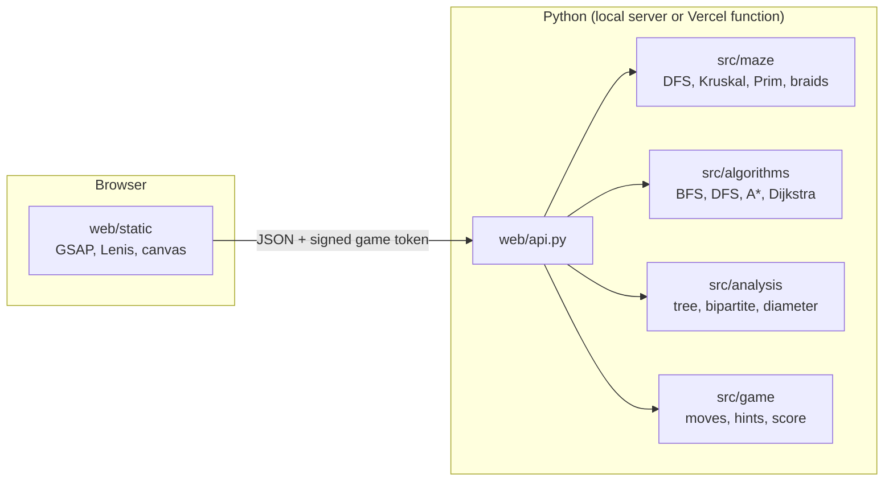

<div align="center">



<br>

**Generate random mazes as spanning trees, solve them with BFS, DFS and A\*, and try to beat the computer yourself.**

<br>


[**Run locally**](#run-it) &nbsp;/&nbsp; [How it works](#how-it-works) &nbsp;/&nbsp; [The maths](#discrete-mathematics-inside) &nbsp;/&nbsp; [API](#web-api) &nbsp;/&nbsp; [Team](#team)

</div>


## The idea

Each cell of a grid is a **vertex** and each open passage between two neighbouring cells is an **edge**. A maze with no loops is therefore a **spanning tree** of the grid graph: it reaches every cell and has exactly one route between any two cells, so it has `|E| = |V| - 1` edges.

We **generate** the maze with randomized DFS, which walks to random unvisited neighbours and backtracks at dead ends. We **solve** it with BFS, which explores in layers of increasing distance and therefore always finds a shortest path. Then we hand the maze to **you**: every move is checked against the edge set, and when you reach the exit your walk is scored against the BFS-optimal path.

## BFS against DFS

<div align="center">

</div>

Both images above are rendered from this repository's own `generate_maze_dfs`, `bfs` and `dfs` (see [`scripts/readme_art.py`](scripts/readme_art.py)). In a perfect maze there is only one route, so both searches find paths of the same length. What differs is **how much of the maze each one explores** before reaching the exit. On braided mazes (with loops) only BFS is guaranteed to find the shortest route.


## What you can do

| | |
|---|---|
| **Play** | Walk from start to exit with the arrow keys, a swipe, or the on-screen pad. Walls block you, hints cost points. |
| **Race** | Run BFS, DFS and A\* on the same maze at once and compare cells explored, path length and runtime. |
| **Inspect** | Read the maze as a graph: vertices, edges, degree sum, cycles, dead ends, diameter, difficulty, and checks for connected, tree and bipartite. |
| **Count** | Ask how many different perfect mazes fit on a small grid. The Matrix-Tree theorem answers exactly. |
| **Tune** | Easy, medium, hard or custom size; DFS, Kruskal or Prim generator; corner or diameter start and exit; any seed. |

The same game also runs as a **desktop app** in pygame, with the animated BFS solution and a side-by-side BFS vs DFS race.

## Run it

Requires **Python 3.10 to 3.13** (pygame has no wheel for 3.14 yet).

```bash
python -m venv .venv
.venv\Scripts\Activate.ps1          # Windows PowerShell
# source .venv/bin/activate         # macOS / Linux
pip install -r requirements.txt
```

| What | Command |
|---|---|
| Web version at http://127.0.0.1:8000 | `python web/server.py` (add `--open` to launch the browser) |
| Desktop version | `python main.py` |
| Tests | `pytest` |
| Maze as ASCII art | `python scripts/demo_generator.py` |
| Regenerate the README animations | `python scripts/readme_art.py` |
| Deploy to Vercel | `vercel deploy --prod` |

The web server uses only the standard library. The page loads GSAP, ScrollTrigger and Lenis from public CDNs, so the browser needs an internet connection.

<details>
<summary><b>Certificate errors on Windows or campus networks</b></summary>

If `pip install` or `git pull` fails with `CERTIFICATE_VERIFY_FAILED`, use the Windows certificate store; certificates are still checked:

```bash
pip install --use-feature=truststore -r requirements.txt
git -c http.sslBackend=schannel pull
```
</details>


## How it works



**The server is the referee.** The browser never decides whether a move is legal or what the score is. Every game is a signed token holding the maze settings (the seed makes the maze reproducible), the moves so far, the hint count and the clock. On each request the server checks the signature, rebuilds the maze, replays the moves through `PlayerController`, applies the new action and returns a fresh token. This keeps the API stateless, which is what lets it run as a Vercel serverless function.

**Scoring.** The BFS path length is a lower bound on any walk from start to exit, so

```
score = optimal_moves / your_moves  -  0.05 x hints  -  0.01 x backtracks      (clamped to 0..1)
```

A score of 1 is **Perfect**, 0.8 and up **Great**, 0.5 and up **Good**, otherwise **Keep trying**. A backtrack is a step straight back onto the cell you just left.

## Discrete mathematics inside

| Concept | Where it lives |
|---|---|
| Graphs as adjacency lists (cells are vertices, passages are edges) | `MazeGraph` in `src/maze/graph.py` |
| Handshake lemma: the degree sum equals 2\|E\| | `edge_count()`, `degree_distribution()` |
| Trees: a perfect maze is a spanning tree with \|E\| = \|V\| - 1 | `is_tree()` in `src/analysis/properties.py` |
| Randomized DFS with backtracking (generation) | `generate_maze_dfs()` in `src/maze/generator.py` |
| BFS: shortest paths in an unweighted graph | `bfs()` in `src/algorithms/solvers.py`, hints and scoring |
| BFS: connectivity | `is_connected()` |
| DFS for solving | `dfs()` |
| Parent-pointer trees for path reconstruction | `reconstruct_path()` |
| Bipartite graphs: the grid is 2-colourable | `is_bipartite()` |
| Degree analysis: degree-1 vertices are dead ends | `count_dead_ends()`, `difficulty_score()` |
| Tree diameter by double BFS | `tree_diameter()`, `pick_start_and_goal(mode="diameter")` |
| Cycles: adding an edge to a tree closes exactly one cycle | `add_braids()` |
| Dijkstra's algorithm (weighted edges) | `dijkstra()` |
| A\* search with the Manhattan heuristic | `a_star()` |
| Kruskal's algorithm with union-find | `generate_maze_kruskal()` |
| Prim's algorithm | `generate_maze_prim()` |
| Kirchhoff's Matrix-Tree theorem (counting spanning trees) | `count_spanning_trees()` |


## Web API

All responses are JSON. Every call that changes a game returns a new `id` token to use next.

| Method | Path | Does |
|---|---|---|
| `POST` | `/api/games` | New game. Body: `difficulty` (`easy`, `medium`, `hard`, `custom`), `algorithm` (`dfs`, `kruskal`, `prim`), `mode` (`corners`, `diameter`), optional `seed`, and `rows`, `cols`, `braid` for `custom`. |
| `POST` | `/api/games/<id>/move` | Body `{"direction": "up"}`. Returns whether it moved, the player state, and the scored result at the exit. |
| `POST` | `/api/games/<id>/hint` | Next cell on the shortest path from where you stand. |
| `POST` | `/api/games/<id>/restart` | Same maze, back to the start. |
| `GET` | `/api/games/<id>/solve?algorithm=bfs` | Explored order and path for `bfs`, `dfs` or `a_star`. Marks the game as solution revealed. |
| `GET` | `/api/games/<id>/compare` | BFS, DFS and A\* on the same maze, with a one-line verdict. |
| `GET` | `/api/demo?rows=5&cols=20` | A wide maze and its BFS search (the landing animation). |
| `GET` | `/api/spanning-trees?rows=3&cols=3` | Number of spanning trees of a grid up to 6 x 6. |

Set the `MAZE_SECRET` environment variable in production so game tokens are signed with your own key.

## Controls

| Key | Browser | Desktop |
|---|---|---|
| Arrow keys | Move (while the board is on screen) | Move |
| `H` | Hint | Hint |
| `S` | Show the BFS solution | Show the BFS solution |
| `R` | New maze | New maze |
| `C` | | BFS vs DFS race |
| `1` `2` `3`, `ENTER` | | Pick difficulty, start |
| `ESC` | Close the result card | Back to the menu |

On a phone, swipe on the maze or use the on-screen pad.

## Project structure

```
maze-solver-game/
├── main.py                  pygame app: menu, play, solve, compare, game over
├── src/
│   ├── config.py            grid size, colours, FPS, difficulty levels
│   ├── maze/                MazeGraph, DFS / Kruskal / Prim generators, braids
│   ├── algorithms/          BFS, DFS, Dijkstra, A*, path reconstruction
│   ├── analysis/            connectivity, tree, bipartite, dead ends, diameter, Matrix-Tree
│   ├── game/                PlayerController, scoring
│   └── ui/                  pygame renderer, search animation, BFS vs DFS race
├── web/
│   ├── api.py               JSON API and signed, stateless game tokens
│   ├── server.py            standard-library HTTP server (also used on Vercel)
│   └── static/              index.html, css/style.css, js/maze.js, js/app.js
├── api/index.py             Vercel serverless entry point
├── vercel.json              static files plus the /api function
├── tests/                   123 tests: generator, solvers, properties, game, UI, API
├── scripts/                 ASCII demo, maze viewer, pygame race demo, README art
└── docs/                    report notes, Role 3 notes, README animations
```

<details>
<summary><b>Notes for teammates: using each module</b></summary>

<br>

**Maze (`src/maze`)**
- Use `graph.rows` and `graph.cols` for the size. `graph.has_edge(a, b)` never raises; it returns `False` for cells outside the grid.
- `graph.neighbors(cell)` raises `ValueError` outside the grid and returns a copy, as does `to_dict()`.
- `add_edge` / `remove_edge` raise `ValueError` unless the cells are in bounds and orthogonally adjacent.
- `add_braids(graph, factor, seed=None)` changes the maze in place and returns it. Pass the generator's seed to make a whole level reproducible.
- `pick_start_and_goal(graph, mode="corners" | "diameter")`.
- All three generators take `(rows, cols, seed=None)`; the same seed always gives the same maze.

**Solvers and analysis (`src/algorithms`, `src/analysis`)**
- Every solver returns a `SearchResult`: `path` (`None` if unreachable), `explored_count`, `explored_order`, `runtime_ms`.
- `explored_order` includes the goal, so `explored_count == len(explored_order)`.
- `compare_algorithms` returns `{"bfs", "dfs", "a_star"}` results.
- `difficulty_score` is in [0, 1] and raises `ValueError` if the goal is unreachable. `count_spanning_trees(3, 3) == 192`.

**pygame UI (`src/ui`)**
- `step()` advances an animation and `draw()` renders it: call `step()` in `update_*` and `draw()` in `render_*`. See [docs/ROLE3_README.md](docs/ROLE3_README.md).

**Game (`src/game`)**
- `PlayerController(graph, start, goal)`; `try_move(direction)` returns `False` for a wall or the outer edge and leaves the state unchanged.
- `path` always starts with `start`, so `len(path) == moves + 1`.
- Penalties and rating thresholds are constants at the top of `scoring.py`.

</details>


## Team

<div align="center">

| Tanaya Thorat | Viral Dhoka | Harshali Thakur | Shreenath Utekar |
|:---:|:---:|:---:|:---:|

| Role | Covers |
|---|---|
| Graph and maze generation | `src/maze`: graph structure, randomized DFS, braids, Kruskal, Prim |
| Algorithms and graph analysis | `src/algorithms`, `src/analysis`: BFS, DFS, Dijkstra, A\*, property checks |
| Visualization and animation | `src/ui`: pygame rendering, search animation, BFS vs DFS race |
| Game logic, integration and web | `src/game`, `main.py`, `web/`: moves, scoring, the browser version and its API |

Discrete Mathematics course project.

</div>
